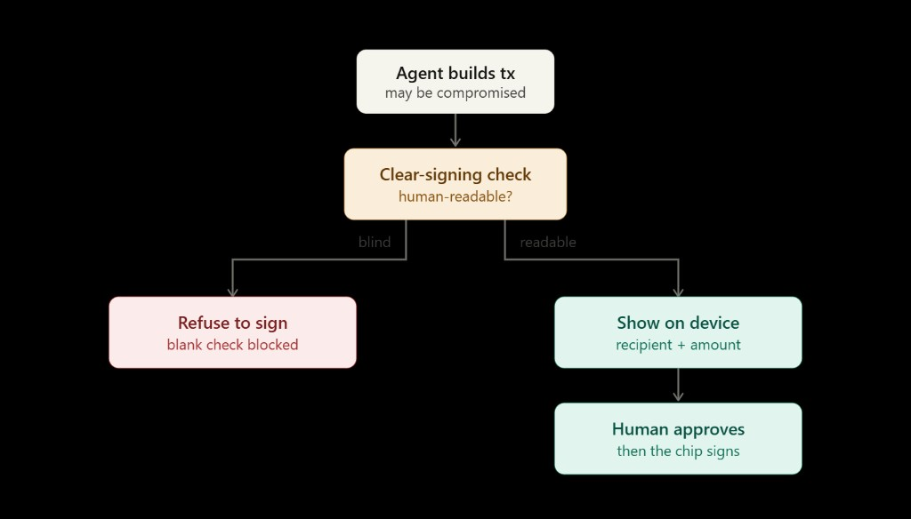

# ClearGate

**Refuse to sign what you can't read.**

An autonomous EVM agent that refuses to sign any transaction the device cannot render in plain language. If the runtime is compromised, a blank check never reaches your Ledger — the gate runs **before** DMK talks to the device.

> **Primitive:** No ERC-7730 clear-sign resolution → no signature. Deterministic, not probabilistic.

Built for the [Ledger EVM bounty](https://developers.ledger.com/) — demonstrates the blind-signing gap, then fixes it with an upstream gate.

**Caption:** *"The hardware worked. The runtime lied."*

---

## Demo

| Beat | Command | Outcome |
|------|---------|---------|
| 1 — Clear sign | `npm run demo:clear-sign` | Gate **PROCEED** → readable tx on device → **SIGNED CLEAR** |
| 2 — Naive attack | `npm run demo:attack-naive` | Middleware rewrite → blind sign → **SIGNED BLIND** |
| 3 — Gated defense | `npm run demo:attack-gated` | Same attack → gate **REFUSED** → never reaches device |

**Attack model:** tampered transport middleware rewrites the payload in flight (not npm supply chain). The agent builds honest intent; what gets signed is opaque.

Works on **any EVM chain** — set `CHAIN_ID` and `RPC_URL`. Built-in profiles: Mainnet, Sepolia, Holesky, Polygon, Base, Arbitrum, Optimism.

---

## Architecture



```
Agent builds tx
      ↓
ERC-7730 clear-sign check (gate)
      ↓
  blind? ──yes──→ REFUSE (tx never reaches device)
      │
      no
      ↓
DMK → Ledger → human approves → chip signs
```

| Stage | What happens | Code |
|-------|----------------|------|
| Agent builds tx | Autonomous agent proposes a transfer — runtime may be compromised | `src/agent/agent.ts` |
| Clear-signing check | ERC-7730 resolves to human-readable fields? | `src/gate/clearSignGate.ts` |
| **blind** → Refuse | No descriptor → auto-refuse | `decision: "refuse"` |
| **readable** → Sign | DMK shows recipient + amount → human approves | `src/ledger/sign.ts` |

**Trust model:** Human judgment is the last line of defense only when the device can show the truth. The gate removes the case where hardware "works" but shows nothing readable.

---

## Quick start (no device)

```bash
npm install
cp .env.example .env    # Windows: copy .env.example .env

npm run demo:gate       # clear vs blind verdicts only
npm test                # gate unit tests
npm run demo:all        # all three beats, dry run (no device)
```

---

## Speculos (no physical Nano)

Docker Desktop + [Speculos](https://github.com/LedgerHQ/speculos) = valid proof-of-use for the bounty. Full guide: **[docs/SPECULOS.md](docs/SPECULOS.md)**.

**Terminal 1** — start emulator:

```powershell
cd c:\path\to\ledger
npm run speculos:fetch-elf   # one-time: download Ethereum app → apps/ethereum.elf
npm run speculos:up          # open http://localhost:5000
```

**Terminal 2** — run demos:

```powershell
cd c:\path\to\ledger
copy .env.example .env       # TRANSPORT=speculos, CHAIN_ID=1
npm run speculos:wait
npm run demo:clear-sign
npm run demo:attack-naive    # enable blind signing in emulator Settings first
npm run demo:attack-gated
```

Or all beats with device:

```bash
npm run demo:all -- --device
```

**Recording:** set `AUTO_APPROVE=0` in `.env` and click approve in the browser at http://localhost:5000.

---

## Physical Ledger Nano (USB)

See **[docs/DEVICE.md](docs/DEVICE.md)**. Set `TRANSPORT=hid` in `.env`, connect Nano, unlock, open Ethereum app.

---

## Configuration

Copy `.env.example` → `.env`. **Do not commit `.env`.**

| Variable | Example | Description |
|----------|---------|-------------|
| `CHAIN_ID` | `1` | EVM chain ID (mainnet for full ERC-7730 USDT descriptor) |
| `RPC_URL` | public RPC | Override for custom chains |
| `TRANSPORT` | `speculos` | `speculos` (emulator) or `hid` (USB Nano) |
| `SPECULOS_URL` | `http://127.0.0.1:5000` | Speculos REST / device UI |
| `AUTO_APPROVE` | `0` | `1` = auto-confirm on Speculos (manual clicks better for recording) |
| `LEDGER_ORIGIN_TOKEN` | *(empty)* | Optional DMK metadata token — leave empty unless Ledger provides one |

Demo addresses (`RECIPIENT`, `ATTACKER`) are public test vectors from the [Foundry book](https://book.getfoundry.sh/) — not real wallets.

---

## Limits

Clear signing depends on **descriptor coverage**. This agent trades **availability for safety**:

- Blocks any tx that would require blind signing
- May block legitimate txs until a descriptor exists
- Does not claim "physically impossible to rob" — states precisely what it protects and what it costs

---

## Docs

| File | Purpose |
|------|---------|
| [docs/SPECULOS.md](docs/SPECULOS.md) | Docker + emulator setup, blind-signing settings |
| [docs/DEVICE.md](docs/DEVICE.md) | Physical Nano via USB |
| [docs/VIDEO.md](docs/VIDEO.md) | Shot list and voiceover beats |
| [docs/POST.md](docs/POST.md) | Submission thread draft |
| [CHECKLIST.md](CHECKLIST.md) | Build → record → submit checklist |

---

## Stack

- [Ledger DMK](https://developers.ledger.com/docs/device-interaction/getting-started) + Ethereum Signer Kit
- [ERC-7730](https://eips.ethereum.org/EIPS/eip-7730) via `@ethereum-sourcify/clear-signing`
- [viem](https://viem.sh) — multi-chain tx building
- Speculos (default) or Nano via Node HID

---

## Security

- **`.env` is gitignored** — never commit it. Only `.env.example` belongs in the repo.
- Do not put private keys, mnemonics, or `LEDGER_ORIGIN_TOKEN` values in tracked files.
- Speculos uses the public test seed (`abandon × 11 about`) in `docker-compose.yml` — emulator only, no real funds.
- `apps/*.elf` is gitignored; run `npm run speculos:fetch-elf` after clone.

Before your first push:

```powershell
cd c:\path\to\ledger
npm run verify:push           # fails if .env or ethereum.elf would be committed
git status                    # .env must NOT appear in untracked/staged lists you add
git check-ignore -v .env      # should show .gitignore rule
```

### First push to GitHub

```powershell
cd c:\path\to\ledger
git init
git add .
git status                    # confirm: no .env, no apps/ethereum.elf, no node_modules
git commit -m "ClearGate: ERC-7730 gate before Ledger signing"
git branch -M main
git remote add origin https://github.com/YOUR_USER/clear-gate.git
git push -u origin main
```

Replace `YOUR_USER/clear-gate` with your repo URL. Create the empty repo on GitHub first (no README — this repo has one).

---

## License

MIT
