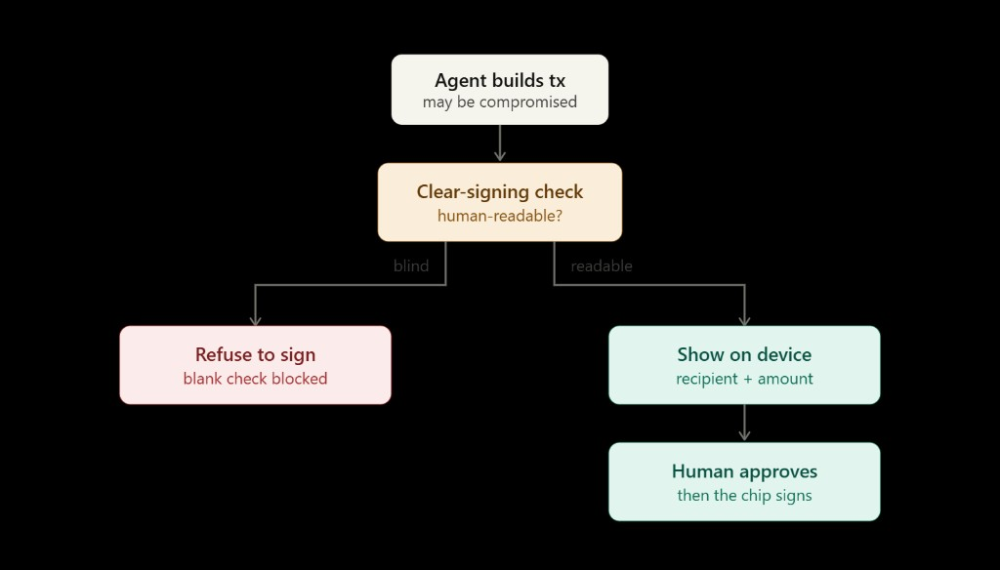

# Post draft (thread)

## Tweet 1 — hook + video

I gave an AI agent live access to my wallet, kept the keys on a Ledger — and it still got robbed.

Then I fixed the part the hardware can't fix on its own.

[90s demo video]

The agent only signs what your device can show in plain language. Everything else gets refused before you ever see an approve button.

@Ledger #Sponsored #LedgerSponsor

---

## Tweet 2 — the gap

Every "Ledger in the loop" demo assumes you can read the screen and say no.

That only works when the transaction is clear-signable.

When it isn't, the device falls back to blind data — hashes and hex — and approving that is signing a blank check.

Hardware can't protect you from what it can't render.

---

## Tweet 3 — beat 2

In the demo, a compromised RPC middleware rewrites a normal transfer in flight.

On a naive setup:
→ Agent builds what looks like a send
→ Middleware swaps the payload
→ Ledger can't resolve ERC-7730 fields
→ Screen shows blind signing data
→ User trusts the hardware and approves
→ Funds drain on-device

Having a Ledger didn't save me. Clear signing coverage did.

---

## Tweet 4 — beat 3 + architecture

Same attack. Same agent. One rule:

**No readable intent → no signature.**

Before any tx hits the device:
1. Resolve ERC-7730 descriptor
2. Fields render → proceed to sign
3. Blind fallback required → auto-refuse

The malicious tx never reaches your thumb.

---

## Tweet 5 — tradeoff (trust line)

This isn't "impossible to rob."

It's a deliberate trade: **availability for safety.**

Some legitimate txs get blocked until someone ships a descriptor. That's the cost of never presenting a blank check.

I'd rather miss a tx than sign one I can't read.

Repo: [GitHub link]

---

## Tweet 6 — CTA

Built with Ledger DMK + Speculos on EVM.

Stack: autonomous agent → clear-sign gate → DMK → device.

[Google Form link]

---

## Qualifier checklist

- [ ] @Ledger tag on main tweet
- [ ] #Sponsored or #LedgerSponsor visible in thread or video
- [ ] Proof-of-use attached (screenshot / demo log / tx hash from Speculos run)
- [ ] Public repo linked
- [ ] Google Form submitted
